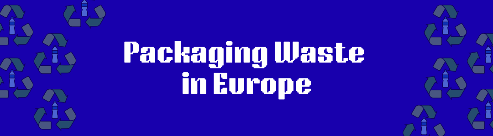
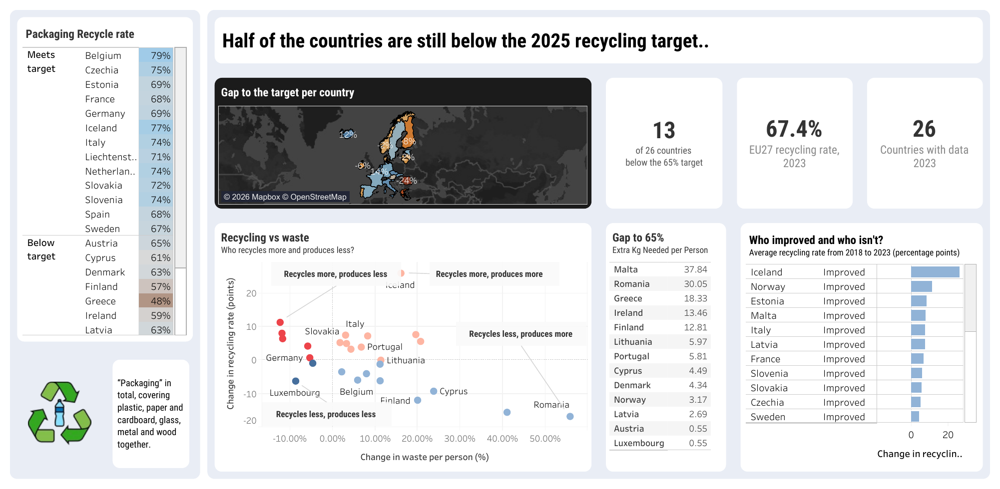
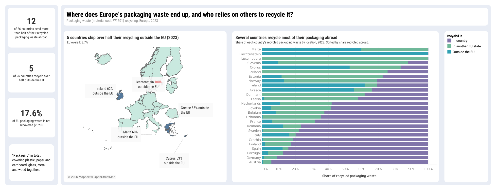

# Packaging Waste and the Circular Economy in Europe

**Which countries are furthest from the EU packaging recycling target, and is progress coming from recycling more or from producing less waste?**

*Click the image to open the live dashboard.*

A learning portfolio project. Eurostat data, 2014–2023. I compare 2018 with 2023.

## Key findings

- **Europe is split in half.** In 2023, 13 of 26 countries met the 65% target and 13 did not. The EU27 as a whole reached 67.4%, because big countries like Germany and France pull the total up.
- **Romania (41.0%), Malta (43.4%) and Greece (48.0%) are furthest behind.** Romania and Greece also fell the most since 2018. Part of that fall may come from a stricter counting method Eurostat started in 2020.
- **The biggest gain needs a warning.** Iceland rose 26.1 points, but most of that is a change in how Iceland reports.
- **Improved on both, 2018 to 2023:** only five countries recycled more and produced less waste per person: Norway, Estonia, France, Sweden and Germany. Germany's gain is only +0.8 points.
- **12 of 26 countries send more than half of their recycled packaging waste abroad** (to another EU state or outside the EU).
- **5 of 26 countries send more than half of their recycling outside the EU:** Liechtenstein 100%, Ireland 62%, Malta 60%, Greece 55%, Cyprus 53%. For the EU as a whole the share is 8.7%.
- **17.6% of EU packaging waste was not recovered in 2023.** It was not recycled, used for energy or recovered in another way. This is not the same as landfill.

## Questions

1. Which countries are furthest from the 65% target in 2023?
2. Which countries improved or got worse between 2018 and 2023?
3. In which years did a country's recycling rate go up while its waste per person went down?
4. How many kg per person would each country still need to recycle to reach 65%?
5. Where does packaging waste end up, and which countries rely on others to recycle it?

## Tools

- **Google Sheets:** cleaning and KPIs ([my sheet](https://docs.google.com/spreadsheets/d/1-qQ3Yn0c9Sn_sHjXvETQ8XxnvaGpWN-r03ozD3PPOw0/edit?usp=sharing))
- **Tableau Public:** two dashboards
- **Claude Code:** help with documentation and checking

## Data

| Source | How I used it |
|---|---|
| [Eurostat `env_waspac`](https://ec.europa.eu/eurostat/databrowser/view/env_waspac/default/table): packaging waste by country, year and operation | Main data, 2014–2023. Downloaded as CSV on 2026-10-16. |
| [Eurostat `env_waspacr`](https://ec.europa.eu/eurostat/databrowser/view/env_waspacr/default/table): Eurostat's own published recycling rates | Only to cross-check my rates (2009–2018). |
| Directive 94/62/EC Art. 6(1), as amended by Directive (EU) 2018/852 ([EUR-Lex summary](https://eur-lex.europa.eu/en/legal-content/summary/packaging-and-packaging-waste.html), checked 2026-10-16) | The targets: 65% by 2025, 70% by 2030. |

- **31 reporters:** the 27 EU countries, Norway, Iceland, Liechtenstein, and the EU27 total.
- **Unit:** kg per person (Eurostat calls it "per inhabitant"). This makes small and big countries comparable.
- **"Packaging" means all packaging** (Eurostat code `W1501`): paper, plastic, glass, metal, wood and other together. It is not plastic only. I have no breakdown by material, so I make no claims about plastic.
- Regulation (EU) 2025/40 replaces the Directive. I did not review it, so I use the 2018/852 targets.

## What I did

1. Downloaded two Eurostat tables and kept the originals untouched.
2. Cleaned them in Google Sheets: kept the columns I needed, filled in country names, turned years into numbers, and kept the EU27 total apart from the countries.
3. Checked the units and Eurostat's warning flags before calculating. For example, `b` means **break in series**: the way a number is measured changed, so it is not fully comparable with earlier years.
4. Built a fact table (one row per country and year) and a targets table.
5. Calculated the KPIs with formulas (see [methodology](docs/methodology.md) and [data dictionary](docs/data-dictionary.md)).
6. Checked my rates against Eurostat's published rates.
7. Built two dashboards in Tableau Public.

## KPIs

**Recycling rate** = waste recycled ÷ waste generated. I show changes in **percentage points**: 50% to 61% is +11 points (not +22%).

| KPI | Better when | Notes |
|---|---|---|
| Waste per person (kg) | Lower | Rich or trade-heavy countries can score high, so compare a country with its own past too. |
| Recycling rate | Higher | It also goes up if waste falls while recycling stays the same, so read it with waste per person. |
| Gap to target | Higher | Rate minus 65%. Negative means still behind. |
| Change in recycling rate, 2018–2023 | Higher | Countries already near the top have less room to grow. |
| Kg per person still to recycle | Lower | Only for countries below 65%. Per person, not total tonnes. |
| Five-year average rate (2019–2023) | Higher | Smooths one-off jumps. Not on the dashboard. |
| Decoupling years | "Yes" | Country-years where the recycling rate rose and waste per person fell compared with the year before. Partly built into the maths. Not on the dashboard. |
| Energy recovery share | Depends | Waste burned for energy. Better than landfill, worse than recycling. In the fact table. |
| Export dependency | Depends | Share recycled outside the EU. Exported waste counts as recycled, so a high rate may look better than it is. Dashboard 2. |
| Share recycled abroad | Depends | (recycled in another EU state + recycling outside the EU) ÷ recycling. Dashboard 2. |
| Share recycled outside the EU | Depends | recycling outside the EU ÷ recycling. Same values as export dependency. Dashboard 2. |
| Not recovered share | Lower | (generated − recovery) ÷ generated. Not the same as landfill. Dashboard 2. |

Decoupling is measured year by year. The 2018 to 2023 comparison is a separate check.

## Findings

I keep three things apart: **data** (my numbers), **sources** (what published reports say) and **my view** (my own reading, not proven).

### 1. Where countries stand in 2023

**Data**
- 26 countries have 2023 data: 13 meet 65%, 13 do not. Bulgaria, Croatia, Hungary and Poland have no 2023 data.
- Lowest: Romania 41.0%, Malta 43.4%, Greece 48.0%.
- Highest: Belgium 79.3%, Iceland 77.3%, Czechia 74.7%. Belgium also has the highest five-year average (about 80%).
- The EU27 reached 67.4%.

**My view**
- "The EU met the target" and "half the countries did not" are both true.
- Bulgaria and Hungary were low in 2022, so "lowest in 2023" means lowest among those that reported.

### 2. Why Malta, Greece and Romania are behind

**Sources:** the European Environment Agency (EEA) early-warning reports (2023, using 2018–2021 data) and Eurostat's country notes. They explain the situation then, not the 2023 numbers.

- **Malta** (+7.7 points, still low): low collection of plastic (about 11%) and metal, "mainly due to the lack of related infrastructure"; no domestic plastic recycling plant, so recycling is measured by exports; a fire at the national sorting plant in 2017; only a voluntary deposit scheme for wine bottles. New since late 2022: a deposit scheme for drink containers, mandatory separation and gate fees for commercial waste. ([EEA](https://www.eea.europa.eu/publications/many-eu-member-states/malta), [Eurostat](https://ec.europa.eu/eurostat/cache/metadata/EN/env_waspac_esmswap_mt.htm))
- **Greece** (−15.6 points): low collection (about 15% for glass, 11% for plastic); separation for businesses delayed; unclear split of duties between producers and cities; low trust that sorted waste gets recycled; a low landfill fee (EUR 20 per tonne); possible under-counting of packaging. ([EEA](https://www.eea.europa.eu/publications/many-eu-member-states/greece))
- **Romania** (−16.8 points): a tax on packaging gives companies a reason to under-report; data that doesn't match municipal waste data; weak enforcement; low landfill tax; a deposit scheme only from October 2022. Eurostat notes "better identification of companies placing packaging on the market". ([EEA](https://eea.europa.eu/publications/many-eu-member-states/romania), [Eurostat](https://ec.europa.eu/eurostat/cache/metadata/EN/env_waspac_esmswap_ro.htm))

**My view:** for Romania, counting more companies means more packaging in the total. That alone lowers the rate. So part of the fall may not be less recycling. I can't prove it from my data.

**The 2020 method change affects everyone.** *Sources:* from 2020, Eurostat counts recycling later in the process (at the recycling plant, not after sorting). This gives lower rates and a break in the data ([Eurostat](https://ec.europa.eu/eurostat/cache/metadata/en/env_waspac_esms.htm), [Decision (EU) 2019/665](https://eur-lex.europa.eu/eli/dec_impl/2019/665)). The EEA estimated the effect: Greece 2019 60.1% → 52.9%, Romania 2018 57.9% → 51.2%, Malta 2019 33.7% → 30.3%.

**My view:** my 2018–2023 comparison crosses this change. Part of any fall, especially Greece, Romania, Finland and Cyprus, may be the stricter counting.

### 3. Who improved and who fell

**Data** (2018 → 2023)

| Country | Recycling rate (points) | Waste per person |
|---|---|---|
| Iceland | +26.1 | +16% |
| Norway | +11.4 | −12.4% |
| Estonia | +8.1 | −12.0% |
| Malta | +7.7 | +19.5% |
| Italy | +7.6 | +3.0% |
| France | +6.5 | −11.8% |
| Sweden | +4.3 | −5.9% |
| Germany | +0.8 | −5.4% |
| Cyprus | −9.3 | +23.7% |
| Finland | −12.0 | +20.0% |
| Greece | −15.6 | +41.0% |
| Romania | −16.8 | +55.8% |

**Improved on both, 2018 to 2023:** of the 26 countries, only Norway, Estonia, France, Sweden and Germany. Germany's gain is only +0.8 points.

**Iceland: mostly a reporting change.**
- *Sources:* from 2023, Iceland's producer scheme covers glass, metal and wood, and crushed glass used as building fill now counts as recycled. Eurostat lists breaks in the data (for example, wood generated +478%) and expects corrections. Separate collection also became mandatory in 2023. ([EEA](https://www.eea.europa.eu/publications/many-eu-member-states/iceland), [Eurostat](https://ec.europa.eu/eurostat/cache/metadata/EN/env_waspac_esmswap_is.htm))
- *Data:* 42% in 2022, 77% in 2023. Flagged "definition differs" (`d`) for 2020–2023.
- *My view:* I don't call Iceland "most improved".

**Norway: strong, but the gain isn't explained.**
- *Sources:* Norway's deposit scheme collects almost 99% of plastic bottles and cans, according to its operator Infinitum ([Investigate Europe](https://www.investigate-europe.eu/posts/deposit-return-the-plastic-recycling-success-opposed-by-southern-europe)). Eurostat notes reporting changes in 2022 and 2023 ([Eurostat](https://ec.europa.eu/eurostat/cache/metadata/EN/env_waspac_esmswap_no.htm)).
- *Data:* break flag (`b`) in 2022.
- *My view:* the deposit scheme and the drink packaging tax date from 1999, so they explain Norway's high level, not the rise. The sources I found don't say why the rate went up. Part of it may be reporting changes.

**Estonia**
- *Data:* every Estonia value for 2019 has a break flag (`b`). Its rate went from 60.4% (2018) to 66.2% (2019).
- *My view:* Estonia changed how it measures in 2019, so part of its gain may come from that. I haven't found a source saying what changed.

**Finland**
- *Data:* waste per person jumped from 131.4 kg (2019) to 157.7 kg (2020), while the rate fell from 68.5% to 58.4%.
- *My view:* 2020 is when the stricter method started. A sudden jump in waste looks more like a bigger total under new rules than a sudden drop in recycling. I can't prove it.

**Cyprus**
- *Data:* the 2020–2023 values are flagged as estimated (`e`, `be`).
- *My view:* estimated values are less reliable, so read Cyprus's fall with care.

I haven't researched why France, Sweden and Germany improved.

### 4. How much more each country needs to recycle (2023)

**Data:** extra kg per person to reach 65%, if waste stayed the same.

| Country | Rate | Kg per person |
|---|---|---|
| Malta | 43.4% | 37.8 |
| Romania | 41.0% | 30.1 |
| Greece | 48.0% | 18.3 |
| Ireland | 59.0% | 13.5 |
| Finland | 56.7% | 12.8 |
| Lithuania | 60.7% | 6.0 |
| Portugal | 61.8% | 5.8 |
| Cyprus | 60.7% | 4.5 |
| Denmark | 62.7% | 4.3 |
| Norway | 62.8% | 3.2 |
| Latvia | 63.1% | 2.7 |
| Austria | 64.6% | 0.6 |
| Luxembourg | 64.7% | 0.5 |

**My view:** Romania has the lowest rate, but Malta needs the most, because Malta produces more waste per person (175.6 kg vs 125.4 kg). Austria and Luxembourg are almost there.

### 5. Decoupling years

**Data**
- In 62 of 259 consecutive country-year pairs (24%, EU27 excluded), the recycling rate rose and waste per person fell compared with the year before.
- Most often: Luxembourg (5 years), then France, Estonia and Germany (4 each).
- From 2022 to 2023, 15 countries did it: Czechia, France, Germany, Italy, Latvia, Lithuania, Luxembourg, the Netherlands, Norway, Portugal, Romania, Slovakia, Slovenia, Spain and Sweden.

**My view:** one good year means little, because less waste lifts the rate by itself. Doing it year after year (Luxembourg, France, Estonia, Germany) is a stronger sign.

### 6. Where does packaging waste end up?

**Data** (2023, kg per person, all packaging `W1501`)
- The EU27 produced 177.8 kg of packaging waste per person. 67.4% was recycled, 15.0% used for energy and 0.1% recovered in other ways. 17.6% (31.2 kg per person) was not recovered. "Not recovered" is waste generated minus waste recovered.
- 26 countries have 2023 data. Bulgaria, Croatia, Hungary and Poland are missing.
- 12 of 26 countries recycle more than half of their packaging waste abroad. 5 of 26 recycle more than half outside the EU. For the EU27, the share outside the EU is 8.7%.
- Luxembourg recycles 0% outside the EU, but all of it in another EU state.
- I found no clear link between how much a country recycles outside the EU and how its recycling rate changed from 2018 to 2023. The link is weak and not statistically significant. TODO: confirm the correlation value.

**My view**
- Small countries recycle abroad mostly in other EU states. So "outside the EU" alone understates how much a country relies on others. That's why the dashboard shows all three shares.
- The 50% cut-off is my own choice, not an EU rule.
- Recycling abroad doesn't explain who improved. I don't claim a cause either way.

## Where does it go?

Eurostat gives the share sent outside the EU, but not the destination countries.

- **Liechtenstein:** recycled in Switzerland (Eurostat country metadata).
- **Cyprus:** in 2022, its waste exports (all waste, not only packaging) went to non-EU countries including India, Lebanon, Egypt, Thailand, Pakistan and Israel (Cyprus Business News). TODO: add the article link. For plastic only, an [IUCN report](https://iucn.org/resources/file/governing-plastic-waste-management-republic-cyprus) (2022, data year not stated) says about half of exports go to Greece and 44% to unnamed Asian countries.
- **Ireland, Malta, Greece:** destinations not named in the Eurostat notes. Not yet verified.

More detail in [docs/destinations.md](docs/destinations.md).

## Data checks and limits

**Checks**
- **My rates vs Eurostat's:** 155 country-years overlap (2014–2018, 31 reporters × 5 years). The average difference is 0.13 points. 96.1% are within 1.5 points, and the biggest gap is 2.7 points. Without the EU27 total, the result is the same.
- **Flags:** 165 of 2,093 raw rows have a Eurostat flag (`d` 92, `b` 39, `e` 14, `p` 9, `i` 8, `be` 2, `bd` 1). The fact table doesn't include them yet.
- **Mistakes I fixed:** my first rate formula divided by the wrong column. I caught it by comparing with Eurostat. I also had the gap sign the wrong way round once.

**Limits**
- All packaging only. No plastic or other materials.
- Kg per person only, no total tonnes.
- Only the 65% target. I don't use the 2030 target (70%).
- Eurostat counts exported waste as recycled in the national rate if it is recycled abroad, so a high rate doesn't prove recycling at home.
- 2023 is missing 4 countries. 2022 is the last complete year.
- Since reference year 2020, Eurostat counts recycling at the input to the final recycling process, which lowers rates. Comparisons across 2018 to 2023 cross this break. Breaks in the data for some countries add to this.
- Eurostat names no destination countries.
- "Outside the EU" leaves out shipments to other EU states, so it understates reliance for small countries. Luxembourg recycles 0% outside the EU but all of it in another EU state.
- "Not recovered" is not the same as landfill.
- Liechtenstein is very small, so its 100% reflects a small volume.
- Destination columns are mostly empty before 2018 (22 of 30 countries in 2018, 26 of 26 in 2023; 19 countries have both years), so trends in where recycling happens are not reliable.
- Averages across countries are unweighted: each country counts the same.

## Dashboards

### Dashboard 1: Recycling rates and the 65% target

**[Open the live dashboard](https://public.tableau.com/views/PackagingwasteinEurope/Dashboard-recycleandwaste?:language=en-GB&:sid=&:redirect=auth&:display_count=n&:origin=viz_share_link)**

- Headline numbers: 13 of 26 below target, EU27 at 67.4%, 26 countries with 2023 data
- Recycling rate per country, split into "meets" and "below" target
- Map of the gap to 65%
- Scatter: change in recycling rate vs change in waste per person, 2018–2023
- Extra kg per person needed to reach 65%
- Change in recycling rate per country, 2018–2023

The embed code for dashboard 1 is in [docs/tableau-embed.html](docs/tableau-embed.html), for use on a website. GitHub READMEs can't show it.

### Dashboard 2: Where does Europe's packaging waste end up, and who relies on others to recycle it?

- Three headline numbers: 12 of 26 countries send more than half abroad, 5 of 26 send more than half outside the EU, 17.6% of EU packaging waste not recovered
- Map of the five countries that recycle most outside the EU, with the EU overall at 8.7%
- 100% stacked bar of where each country's recycling happens (in the country, in another EU state, outside the EU), sorted by share recycled abroad

**How to read it**
1. The bar shows where each country's recycled packaging waste is processed.
2. The map shows only the five countries above 50% outside the EU.
3. "Packaging" means all materials together (plastic, paper and cardboard, glass, metal, wood), material code `W1501`.

## Contact

**Eliza C. Huang**

Data Analyst with a background in UX and data-driven analysis. Interested in high-impact roles across Public Policy, NGOs, Human Rights, as well as industries such as Technology, Supply Chain & Logistics, Healthcare, Sustainability, and FinTech.

- 📊 Tableau Public: https://public.tableau.com/app/profile/eliza.c.huang/vizzes
- 💼 LinkedIn: https://www.linkedin.com/in/chuyunh/
- 📸 Instagram: DataDrawers — https://www.instagram.com/datadrawers/
